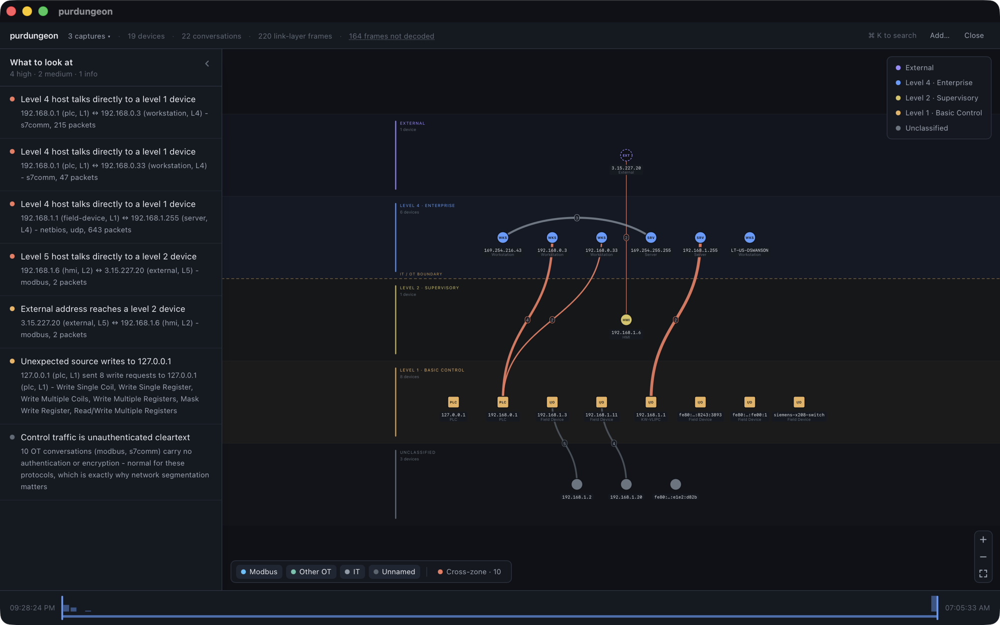

# purdungeon

Drop a packet capture on the window and see the OT network inside it: every device, its likely role, where it sits in the Purdue model, who it talks to, and which of those conversations deserve a closer look.
Industrial networks are mapped by listening, not scanning, because an active probe can knock over a controller; purdungeon turns a passive capture from a span port into a reviewable topology in seconds, with every claim traced back to the packets that made it.
It is a modern, open-source take on [GrassMarlin](https://github.com/nsacyber/GRASSMARLIN): a Rust analysis core under a small Tauri and Vue desktop app, fully offline, nothing leaves the process.



## What it does

1. **Reads captures.** pcap and pcapng (microsecond and nanosecond timestamps, snaplen-truncated, multi-section and cut-off files included) from Ethernet, VLAN-tagged, Linux cooked (`tcpdump -i any`), raw-IP and loopback captures.
   IPv4, IPv6 and ARP are decoded; LLDP and CDP are recognised; Modbus TCP is parsed down to function codes, unit IDs and coil/register accesses; other protocols are named by port.
   Every frame it cannot decode is counted by reason and shown in the header rather than silently dropped.
2. **Collects evidence.** What devices say about themselves over DHCP, NetBIOS, mDNS, LLMNR, SNMP, LLDP and CDP is kept as rows of device, kind, value, source protocol, confidence and count.
   Names, MAC addresses and switches that only ever announce themselves come from here.
3. **Infers roles.** Every host gets a role (PLC, SCADA/master, HMI, engineering workstation, historian, network gear, server, workstation) and a Purdue level, from its traffic first and its evidence second, each as a best guess with a confidence and a quoted reason.
   Both are overridable in the UI.
4. **Draws the Purdue view.** Devices sit in horizontal bands by level, process at the bottom and enterprise at the top, with the IT/OT boundary marked.
   Node colour is the level, the shape and glyph are the role, link colour is the protocol family and link width is volume.
   Conversations that skip a level or cross the control/IT boundary are drawn in the alert colour.
5. **Surfaces findings.** A list of what a consultant checks first: cross-zone conduits, who writes to controllers, external addresses on OT segments, scan-like behaviour, cleartext control protocols.
   Each finding highlights its devices and conversations on the canvas.
6. **Explains on click.** Any device or link opens a panel with identity, classification, the evidence behind both, per-register read/write activity, function-code breakdown and polling cadence.
7. **Stitches captures.** Several files from the same site load as one session, each with its own progress bar.

## Install

Prebuilt installers are attached to each [release](https://github.com/napahlm/purdungeon/releases) (macOS `.dmg`, Windows `.msi`, Linux `.AppImage` and `.deb`).
The binaries are unsigned, so macOS asks you to allow the app in System Settings on first launch.

To build from source you need [Rust](https://rustup.rs/) (stable), [Node.js](https://nodejs.org/) 20+ and [pnpm](https://pnpm.io/).
Windows additionally needs WebView2 (pre-installed on Windows 10 and 11) and the Visual Studio Build Tools with the C++ workload; Linux needs `libwebkit2gtk-4.1-dev` and friends (see the [Tauri prerequisites](https://v2.tauri.app/start/prerequisites/)).

```bash
pnpm install
pnpm dev            # desktop app with hot reload
pnpm build          # release binary and installers under target/release/bundle
```

On first run, click **open the sample captures** on the start screen, or pass captures on the command line:

```bash
./target/debug/purdungeon examples/icsnpp-profinet-mixed.pcap
```

The three captures in [`examples/`](examples/README.md) are small public ICS traces from CISA's ICSNPP project.

## Architecture

The analysis is a headless Rust crate with no UI dependencies.
The desktop app is a thin Tauri shell that exposes the crate over IPC, and a Vue frontend that only ever draws what the shell hands it.
That split keeps the hot path (parsing a 200 MB capture) in Rust on a worker thread, keeps the UI responsive, and leaves the core reusable from a CLI or a test harness.

```
pcap / pcapng
     |
     v
crates/core  (Rust, purdungeon-core)
  ingest/     pcap-parser + etherparse: link-type normalisation, frame classification, VLAN, cooked captures
  protocols/  pure decoders, bytes in and facts out: Modbus, ARP, LLDP, CDP, DHCP, DNS/mDNS/LLMNR, NetBIOS, SNMP
  store/      one SQLite file per session: hosts, connections, packets, evidence, modbus_events, findings, node_positions
  analysis/   identity resolution, protocol naming, role and Purdue inference, findings
     |
     |  Session { import, add_capture, hosts, connections, host_detail, findings, ... }
     v
src-tauri  (Rust, Tauri 2)
  commands/import.rs   runs an import on the blocking pool, emits import-progress and import-stage events
  commands/query.rs    async read commands over the session, so a slow query never freezes the window
  commands/open.rs     captures from the command line, OS "Open with", and the bundled samples
     |
     |  invoke() / listen()
     v
src  (TypeScript, Vue 3 + Pinia + Konva + Tailwind)
  composables/useTauri.ts  the IPC surface and the import queue (one worker, one row per file)
  stores/                  app (session, jobs, frame accounting), topology (graph, layout, filters, search), timeline
  canvas/                  Konva renderers for nodes and links, palette from the CSS design tokens
  components/              canvas, panels, findings, filters, timeline, loading
```

A few decisions worth knowing:

- **Everything is a row.** Hosts, conversations, evidence and findings live in a per-session SQLite database, written once at the end of a parse. Every number in the UI is a query, and every claim in a report can be traced to the packets behind it.
- **Frame accounting reconciles.** `frames_read == packet_count + skipped` always holds, and the header shows what was skipped and why.
- **Roles are guesses, labelled as such.** Traffic outranks self-description, self-description outranks fingerprints, and each role quotes its reason. Overrides are stored, never inferred away.
- **Colour means one thing.** Node colour is the Purdue level, link colour is the protocol family, and amber and coral are reserved for findings and cross-zone traffic. `src/style.css` is the single source of colour; the canvas reads the same tokens at runtime.
- **The canvas is reconciled, not rebuilt.** Filter, search and timeline changes touch only the delta of the Konva scene, so scrubbing stays smooth on large captures.

## Development

| Command | What it does |
|---------|-------------|
| `pnpm dev` | Desktop app in dev mode (hot reload for the frontend, cargo rebuild for Rust) |
| `pnpm build` | Release binary and installers |
| `just ci` | Everything CI runs: lint, test, licence check |
| `just test` | Every Rust test, including the golden-file tests |
| `just lint` | eslint on the frontend; clippy (pedantic, warnings are errors) on the workspace |
| `just deny` | Check the dependency tree against the licence policy in `deny.toml` |
| `just fetch-corpus` | Download the large public captures listed in `crates/core/tests/corpus/manifest.toml` |
| `just golden-update` | Rewrite the golden snapshots after an intended behaviour change |

`cargo test -p purdungeon-core` runs unit tests, end-to-end imports of synthetic captures that exercise every frame type the reader handles, and golden-file tests.
A golden test imports a fixed capture, summarises what the core made of it (frame accounting, devices, conversations by protocol, VLANs, evidence) and compares that summary with a committed JSON snapshot under `crates/core/tests/golden/`.
The committed captures are the ones in `examples/`, checked by sha256; larger ones are fetch-only and checked with `just golden-corpus` once downloaded.
When a change intentionally alters what the core reports, `just golden-update` rewrites the snapshots; the diff is the behaviour change, review it as such.

CI runs on Linux and Windows: fmt, clippy, the core tests, cargo-deny, eslint and a frontend type-check and build.

## License

MIT, see [LICENSE](LICENSE).
The sample captures in `examples/` are BSD-3-Clause, see [`examples/NOTICE-ICSNPP.txt`](examples/NOTICE-ICSNPP.txt).
